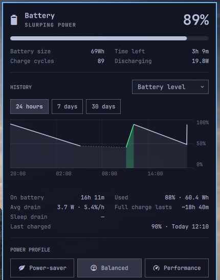

# Battery Insights

Omarchy's own battery panel, unchanged, plus a HISTORY section: your battery
level over the last 24 hours, 7 days or 30 days, battery used per hour or day,
and battery health, one graph at a time behind a dropdown. It replaces the
built-in `omarchy.power` bar widget in place.



A fork of [aabulkhairov/omarchy-battery-insights](https://github.com/aabulkhairov/omarchy-battery-insights),
moved into the stock panel instead of a separate bar button.

## Install

Requires Omarchy 4 (Quattro) on a laptop.

```bash
omarchy plugin add https://github.com/HritwikSinghal/omarchy-battery-insights.git --enable
```

Omarchy puts it exactly where `omarchy.power` was, keeps that widget's settings
(the percentage label), and turns the built-in widget off. Everything that
calls the built-in id still reaches this one: `SUPER+CTRL+P`, the "Show Battery
%" menu item, `omarchy-shell omarchy.power ...`.

Nothing else to install: the logger uses `upower`, `gdbus`, `flock`, GNU `awk`
and coreutils. No sudo, no system services, no network access.

## Remove

```bash
omarchy plugin remove hritwiksinghal.battery-insights
```

This puts `omarchy.power` back in the same slot with its settings
(`omarchy plugin disable` does the same and keeps the plugin installed). The
logs are kept; to delete them too:

```bash
rm -rf "${XDG_STATE_HOME:-$HOME/.local/state}/battery-insights"
```

## The panel

Top to bottom: the stock battery header, charge bar and stats; **HISTORY**;
the stock power profile switcher. The panel scrolls when a screen is too short
for all of it.

| Graph | Shows | Range | Stats under it |
| --- | --- | --- | --- |
| Battery level | charge % over time; charging in the theme's green, asleep or off dotted | 24 h / 7 d / 30 d | on battery, used, average drain, how long a full charge lasts, sleep drain, last charged |
| Usage | battery used per hour (24 h) or per day, awake vs asleep | 24 h / 7 d / 30 d | same |
| Health | maximum capacity against design over the battery's life, the 80% line | none | cycles, age, loss per 100 cycles and per year, measured trend, when it reaches 80% |

Hover a point or bar for its exact time and value. The graph and range you
pick are remembered (in the state directory, not in `shell.json`) and are the
same on every monitor.

## Mouse, keys and IPC

| Input | Action |
| --- | --- |
| Left click on the icon | open or close the panel |
| Right or middle click on the icon | nothing (the stock right-click percentage toggle is gone; use the menu or `togglePercentage`) |
| Dropdown, range buttons | pick the graph and range (mouse only) |
| Arrows or `h` `j` `k` `l`, `Enter` / `Space` | move and pick a power profile (stock) |
| `Tab` / `Esc` | next bar panel / close (stock) |

Upstream's keys (`1` `2` `3`, `r`, left/right for the range, `j` `k` to scroll)
are gone. IPC, on the built-in target:

```bash
omarchy-shell omarchy.power toggle            # also open, close, show, hide
omarchy-shell omarchy.power togglePercentage  # the percentage label in the bar
omarchy-shell omarchy.power graph usage       # level | usage | health; opens the panel
omarchy-shell omarchy.power range 7d          # 24h | 7d | 30d; opens the panel
omarchy-shell omarchy.power state             # the panel's state as JSON
```

## How it works

`Service.qml` runs `bin/battery-insights sample` once a minute and on every
plug or unplug, reading the battery through UPower. At each shell start it also
imports UPower's own history, so the graphs are not empty on day one: that
reaches back about one to two weeks, so 24 h and 7 d fill at once and 30 d
fills in over time. A reading UPower cannot give is skipped, not logged as 0%.
Logging only happens while the widget is in your bar and you are logged in.

Files in `${XDG_STATE_HOME:-~/.local/state}/battery-insights/`:

| File | Holds | Kept |
| --- | --- | --- |
| `samples.csv` | `epoch,percent,energy_wh,full_wh,rate_w,state`, one a minute | 31 days |
| `health.csv` | `date,full_wh,design_wh,cycles`, one a day | forever |
| `ui.json` | the graph and range you picked | |
| `stock-ack` | the Omarchy power panel version last announced (below) | |

`state` is `C` charging, `D` discharging, `F` full, `P` plugged in but holding
(charge limit), `U` unknown.

- **Awake vs asleep**: a gap of more than 5 minutes between on-battery readings
  is sleep (or off); the drop across it is sleep drain.
- **Average drain** is energy used while awake over time awake on battery;
  **full charge lasts** is today's full capacity over that drain.
- **Health** is full-charge capacity over design capacity. *Loss per year*
  averages since the manufacture date the battery reports (not all do).
  *Measured trend* is a least-squares fit over the daily log, shown once it
  spans 14 days and 7 readings; until then the panel says which it still needs.

## When Omarchy updates its battery panel

The panel is a copy of Omarchy's `shell/plugins/panels/power/Panel.qml` and
`Model.js` (see `stock/`). When an Omarchy update changes them, the plugin
sends one notification, "Omarchy changed its power panel", once per new
version. The plugin keeps working on its copy; it only misses whatever Omarchy
changed. On a different Omarchy build than the one copied, this notice shows
once at first start.

## Known limitation

The Omarchy menu's "Show / Hide Battery %" item always says "Show": the menu
reads the setting by the built-in id. Choosing it still toggles the label.

## Develop

```bash
test/run.sh                         # unit tests + stock drift check
tests/e2e/smoke.py "$TMPDIR/bie"    # end to end on a hidden, isolated desktop
```

See [docs/TESTING.md](docs/TESTING.md). Everything the copied `Widget.qml`
changes from Omarchy's `Panel.qml` sits between `LOCAL CHANGE` markers, so a
re-sync is a fresh copy plus those hunks. Errors show up in
`quickshell log -p $OMARCHY_PATH/shell`.

## License

GPL-3.0-or-later, see [LICENSE](LICENSE). Forked from
[aabulkhairov/omarchy-battery-insights](https://github.com/aabulkhairov/omarchy-battery-insights)
and built on [Omarchy](https://github.com/basecamp/omarchy)'s battery panel;
both are MIT-licensed, and their notices are kept in [LICENSE.MIT](LICENSE.MIT).
